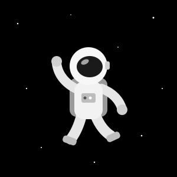

<!-- ===================== BANNER ===================== --> 
  
 <!-- ===================== REDES SOCIAIS ===================== --> <!-- Troque SEU-USUARIO pelos seus usuários reais --> 
     
   <!-- ===================== SOBRE MIM ===================== --> <h2 align="center">🧑‍🚀 <i>Sobre mim</i></h2> 
 

Olá! Eu sou o Antonio Santerra, desenvolvedor full stack apaixonado por tecnologia. Estou no último período do Técnico em Informática para Internet no IFSul, com foco em desenvolvimento Web. Gosto de construir plataformas web completas e de colocar a mão na massa com automação e eletrônica.

 🎓 <i><b>Estudante do Técnico em Informática para Internet — IFSul</b></i>  🌐 <i><b>Desenvolvimento Web full stack</b></i>  🤖 <i><b>Automação de processos e RPA com Arduino e ESP32</b></i>  🌱 <i><b>Aprendendo: React, Next.js, Python e MongoDB</b></i> 

🚀 Aqui você encontra projetos que mostram meu crescimento e aprendizado. Estou aberto a colaborações e sempre disposto a trocar ideias sobre tecnologia!

  <!-- ===================== TECNOLOGIAS ===================== --> <h2 align="center">⚙️ <i>Tecnologias</i></h2> 
 
                  
   <!-- ===================== ESTATÍSTICAS ===================== --> <h2 align="center">📈 <i>Estatísticas</i></h2> 
 
   
 
  
 
  
 <!-- ===================== RODAPÉ ===================== --> 
  

